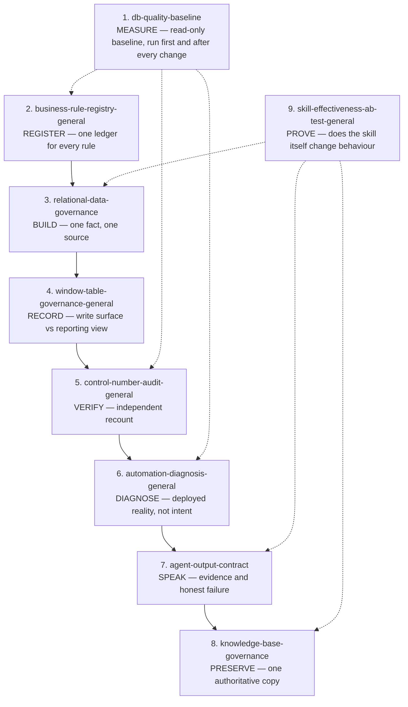
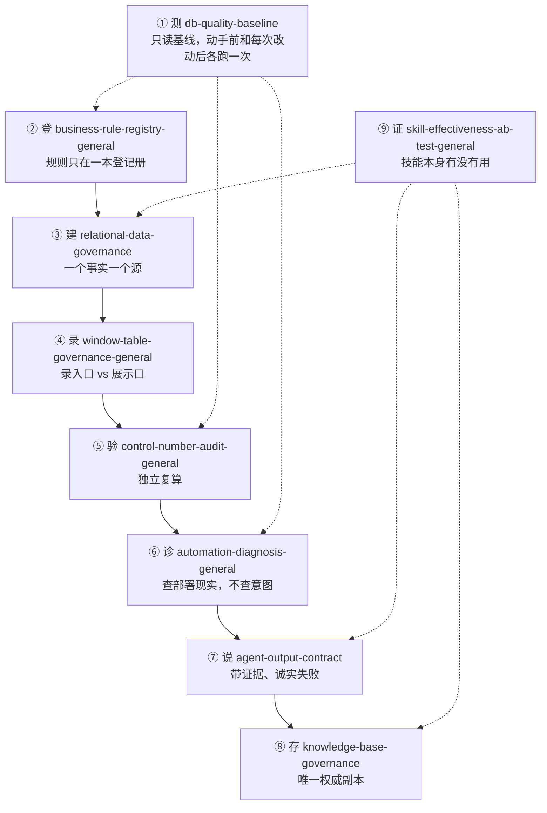

# General-Purpose Governance Skills

Nine portable skills for AI coding agents, distilled from real operational work on data modeling, rules, verification, agent output, knowledge bases and automation that stopped behaving. Seven govern how work is done; one measures the store before anything is changed; one tests whether the skills themselves change what a model does. All examples are synthetic; no customer data, internal identifiers, private links, or credentials are included.

Each skill ships in two languages:

- `SKILL.md` — English, this is what an agent reads
- `SKILL.zh-CN.md` — 中文，给人读

## The nine skills

| Skill | Domain | One-line purpose |
|---|---|---|
| `relational-data-governance` | Data model | Give each fact exactly one write location; derive the rest. |
| `business-rule-registry-general` | Rules | Keep every rule in one registry; change the live artifact and the text together. |
| `window-table-governance-general` | Process / roles | Separate where an action is recorded from where it is reported. |
| `control-number-audit-general` | Verification | Prove a change did not corrupt records, by recounting an independent path. |
| `automation-diagnosis-general` | Diagnosis | When a deployed automation misbehaves, name the layer at fault before changing anything. |
| `agent-output-contract` | Agent behavior | Make an agent answer with evidence, and fail honestly. |
| `knowledge-base-governance` | Documentation | One authoritative copy per rule; read back after every edit. |
| `db-quality-baseline` | Measurement | Measure the store with reproducible read-only checks; baseline before threshold. |
| `skill-effectiveness-ab-test-general` | Proof | Test the skill itself: same cases, one variable, hand-scored. |

Five skills carry a `-general` suffix. This is deliberate: a business-specific edition of the same name may already exist in the user's skill library, and an identical name would collide on install. The `-general` edition is the sanitized, reusable version.

## How they fit together



Read it as one loop: measure where you are, register the rules, build the model, fix where people record actions, verify with an independent recount, diagnose what actually ran when reality disagrees, speak with evidence, then preserve the result as one authoritative copy. Skill 9 is applied to the skills themselves — before changing one and after.

Skills 2–6 are a chain. Skill 7 cuts across all of them. Skill 8 closes the loop. Skill 1 runs before and after, so "it got better" is a comparison rather than an opinion.

A fill-in sheet for skill 1 is in [`templates/db-baseline-input.md`](templates/db-baseline-input.md).

## Install

Copy a skill folder into your agent's skills directory. Nothing else is required — each folder is self-contained.

```text
<agent-home>/skills/relational-data-governance/
    SKILL.md
    SKILL.zh-CN.md
```

`skill-effectiveness-ab-test-general` also ships `scripts/run_ab.sh` (a shell helper); `CLAUDE` must point at a real model CLI executable.

If your library already contains a skill with the same name, either use the `-general` edition alongside it, or merge the two intentionally.

## Status and license

Licensed under the **MIT License** — see [LICENSE](LICENSE). Use, copy, modify, and redistribute freely, including in commercial products; just keep the copyright notice. No warranty is provided.

The skills describe methods, not policy: they do not replace accounting, legal, domain, or data-ownership approval.

---

# 通用治理技能库（中文）

九个可以搬来就用的技能，给 AI 编码助手读。内容来自真实的业务数据建模、规则登记、核验、AI 输出、知识库治理，以及「已经部署的自动化突然不好使」的排查工作。例子全部是合成的，不含任何客户数据、内部标识、私有链接或凭据。

其中七个管「怎么做事」，一个管「这个库到底有多好」——先量，再改；还有一个管「技能本身到底有没有用」——同一批案例跑两次，手判分。

每份技能都有两个语言版本：

- `SKILL.md` —— 英文，给 AI 读的
- `SKILL.zh-CN.md` —— 中文，给人看的

## 九个技能

| 技能 | 管什么 | 一句话 |
|---|---|---|
| `relational-data-governance` | 数据模型 | 每个事实只留一个写入位置，其余靠关系算出来。 |
| `business-rule-registry-general` | 规则 | 每条规则只在一本登记册里；改活体和改文字必须同步。 |
| `window-table-governance-general` | 流程与角色 | 把「在哪录」和「在哪看结果」分开。 |
| `control-number-audit-general` | 核验 | 用另一条独立路径复算，证明改动没改坏数据。 |
| `automation-diagnosis-general` | 诊断 | 部署好的自动化不好使时，先定在哪一层出错，再动手改。 |
| `agent-output-contract` | AI 行为 | 让 AI 带证据回答，查不到就老实说查不到。 |
| `knowledge-base-governance` | 文档管理 | 一条规则只有一份权威副本，每次改完读回。 |
| `db-quality-baseline` | 测量 | 用可复跑的只读检查量出库的真实质量；先有基线，才有合格线。 |
| `skill-effectiveness-ab-test-general` | 自证 | 同一批案例跑两次、只变一个变量，判分证明技能真的改变了行为。 |

有五份带 `-general` 后缀，这是故意的：用户技能库里可能已经有同名的业务专用版，同名装进去会撞。带 `-general` 的是脱敏后的通用版。

## 九个技能的关系



一句话记：**测 → 登 → 建 → 录 → 验 → 诊 → 说 → 存**，另加一个横着用的「证」。

②到⑥是一条链：先把规则登记清楚，再把人动作的落点定准，然后用控制数证明改动没坏事，一旦现实和记录不一致就停在诊断。⑦ 横向贯穿：不管在哪一步，AI 说话都要守规矩。⑧ 收尾：结论只沉淀成一份权威副本。① 是横着用的体检：改之前跑一次当基线，改之后再跑一次做对比——「变好了」是比出来的。⑨ 是自证：这套技能本身也要被同一批案例跑两次，差别只在读没读技能文件。

第一个技能的填空表在 [`templates/db-baseline-input.md`](templates/db-baseline-input.md)。

## 怎么装

把技能文件夹整个复制到你那个 agent 的技能目录里就行，每个文件夹都是自包含的。

```text
<agent 目录>/skills/relational-data-governance/
    SKILL.md
    SKILL.zh-CN.md
```

`skill-effectiveness-ab-test-general` 另外带一个 `scripts/run_ab.sh`；跑之前把 `CLAUDE` 指向真实的模型命令行程序（不要用包装脚本）。

如果库里已经有同名技能，要么把 `-general` 版和它并存，要么明确地把两份合并——别让两份同时「看起来像权威」。

## 状态与许可

采用 MIT 许可证，见仓库里的 LICENSE 文件。可以自由使用、复制、修改、再分发，包括用在商业产品里；只需保留版权声明。不提供任何担保。

这些技能写的是方法，不是制度：它们不能替代会计、法律、业务口径或数据归属方面的审批。
