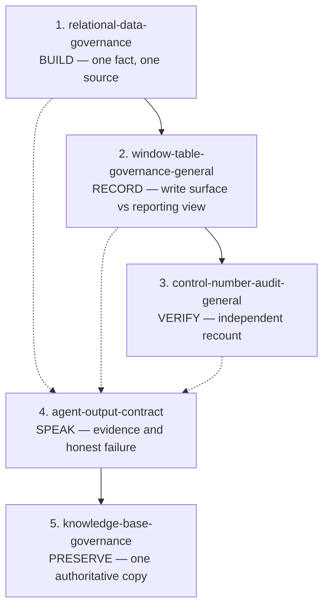
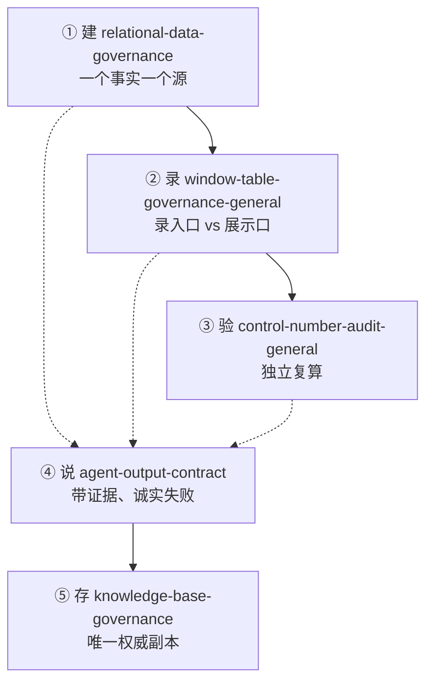

# General-Purpose Governance Skills

Five portable skills for AI coding agents, distilled from real operational work on data modeling, verification, agent output, and knowledge bases. All examples are synthetic; no customer data, internal identifiers, private links, or credentials are included.

Each skill ships in two languages:

- `SKILL.md` — English, this is what an agent reads
- `SKILL.zh-CN.md` — 中文，给人读

## The five skills

| Skill | Domain | One-line purpose |
|---|---|---|
| `relational-data-governance` | Data model | Give each fact exactly one write location; derive the rest. |
| `window-table-governance-general` | Process / roles | Separate where an action is recorded from where it is reported. |
| `control-number-audit-general` | Verification | Prove a change did not corrupt records, by recounting an independent path. |
| `agent-output-contract` | Agent behavior | Make an agent answer with evidence, and fail honestly. |
| `knowledge-base-governance` | Documentation | One authoritative copy per rule; read back after every edit. |

Two skills carry a `-general` suffix. This is deliberate: a business-specific edition of the same name may already exist in the user's skill library, and an identical name would collide on install. The `-general` edition is the sanitized, reusable version.

## How they fit together



Read it as one loop: build the model correctly, fix where people record actions, verify with an independent recount, speak with evidence at every step, then preserve the result as a single authoritative copy.

Skills 1–3 are a chain. Skill 4 cuts across all of them. Skill 5 closes the loop.

## Install

Copy a skill folder into your agent's skills directory. Nothing else is required — each folder is self-contained.

```text
<agent-home>/skills/relational-data-governance/
    SKILL.md
    SKILL.zh-CN.md
```

If your library already contains a skill with the same name, either use the `-general` edition alongside it, or merge the two intentionally.

## Status and license

Licensed under the **MIT License** — see [LICENSE](LICENSE). Use, copy, modify, and redistribute freely, including in commercial products; just keep the copyright notice. No warranty is provided.

The skills describe methods, not policy: they do not replace accounting, legal, domain, or data-ownership approval.

---

# 通用治理技能库（中文）

五个可以搬来就用的技能，给 AI 编码助手读。内容来自真实的业务数据建模、核验、AI 输出和知识库治理工作，例子全部是合成的，不含任何客户数据、内部标识、私有链接或凭据。

每份技能都有两个语言版本：

- `SKILL.md` —— 英文，给 AI 读的
- `SKILL.zh-CN.md` —— 中文，给人看的

## 五个技能

| 技能 | 管什么 | 一句话 |
|---|---|---|
| `relational-data-governance` | 数据模型 | 每个事实只留一个写入位置，其余靠关系算出来。 |
| `window-table-governance-general` | 流程与角色 | 把"在哪录"和"在哪看结果"分开。 |
| `control-number-audit-general` | 核验 | 用另一条独立路径复算，证明改动没改坏数据。 |
| `agent-output-contract` | AI 行为 | 让 AI 带证据回答，查不到就老实说查不到。 |
| `knowledge-base-governance` | 文档管理 | 一条规则只有一份权威副本，每次改完读回。 |

有两份带 `-general` 后缀，这是故意的：用户技能库里可能已经有同名的业务专用版，同名装进去会撞。带 `-general` 的是脱敏后的通用版。

## 五个技能的关系



一句话记：**建 → 录 → 验 → 说 → 存。**

①②③ 是一条链：先把数据模型搭对，再把人动作的落点定清楚，最后用控制数证明改动没坏事。
④ 横向贯穿前三步：不管在哪一步，AI 说话都要守这个规矩。
⑤ 收尾：这几步得出的规则和结论，最后只沉淀成一份权威副本。

## 怎么装

把技能文件夹整个复制到你那个 agent 的技能目录里就行，每个文件夹都是自包含的。

```text
<agent 目录>/skills/relational-data-governance/
    SKILL.md
    SKILL.zh-CN.md
```

如果库里已经有同名技能，要么把 `-general` 版和它并存，要么明确地把两份合并——别让两份同时"看起来像权威"。

## 状态与许可

采用 MIT 许可证，见仓库里的 LICENSE 文件。可以自由使用、复制、修改、再分发，包括用在商业产品里；只需保留版权声明。不提供任何担保。

这些技能写的是方法，不是制度：它们不能替代会计、法律、业务口径或数据归属方面的审批。
